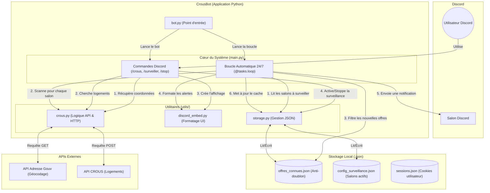

# Architecture de CrousBot

Voici une vue d'ensemble de l'architecture du projet **CrousBot**, un bot Discord conçu pour surveiller les annonces de logements CROUS en temps réel.

## Vue d'ensemble (Diagramme Mermaid)

## Structure du Code et Modules

Le bot est structuré de manière modulaire, séparant la logique Discord des requêtes API et de la persistance des données.

### 1. Le Point d'Entrée
- **`bot.py`** : C'est un script de lancement très simple (4 lignes). Il se contente d'importer la fonction `start()` de `main.py` et de l'exécuter. Cela permet d'isoler le démarrage du reste de la logique.

### 2. Le Cœur du Bot (`main.py`)
Ce fichier orchestre toute l'application grâce à la librairie `discord.py`. Il gère deux aspects principaux :
- **Les Commandes Utilisateur** : Écoute les commandes slash (`/crous`, `/surveiller`, `/stop_surveillance`), interroge les utilitaires pour récupérer les données et répond à l'utilisateur.
- **La Boucle de Surveillance 24/7** : Utilise `@tasks.loop` pour exécuter une fonction toutes les `CHECK_INTERVAL` secondes (par défaut 30s). Elle parcourt la configuration des salons surveillés, vérifie s'il y a de nouvelles offres via l'API, s'assure qu'elles n'ont pas déjà été envoyées (anti-doublon), et envoie une alerte.

### 3. Les Utilitaires (`utils/`)
C'est ici que réside la "logique métier" (business logic) du bot, séparée de l'interface Discord :

- **`utils/crous.py`** : 
  - Gère la conversion des noms de villes en coordonnées GPS (latitude/longitude) via l'**API Adresse du gouvernement** (`obtenir_coordonnees`).
  - Gère la recherche complexe sur l'**API CROUS** (`chercher_crous`) en forgeant les requêtes POST (calcul des délimiteurs de zones géographiques, envoi des bons headers et cookies).
- **`utils/discord_embed.py`** :
  - Centralise la création de l'interface utilisateur Discord (Embed). Il prend un objet JSON brut issu du CROUS et le transforme en une belle carte colorée (loyer, surface, équipements, lien cliquable).
- **`utils/storage.py`** :
  - Abstraction pour la lecture et l'écriture de fichiers JSON. Cela rend le code plus propre et réutilisable.

### 4. Le Stockage Persistant
Pour fonctionner en continu et pouvoir redémarrer sans spammer, le bot sauvegarde son état localement :
- **`offres_connues.json`** : Un cache (Set Python sérialisé) contenant les IDs des logements déjà notifiés. Évite qu'une annonce vue au scan N ne soit renvoyée au scan N+1.
- **`config_surveillance.json`** : Contient la liste des salons Discord où la commande `/surveiller` a été activée, avec les coordonnées et le rayon associé. Si le bot redémarre, il reprendra automatiquement la surveillance de ces salons.
- **`sessions.json`** : Stocke les cookies de session `PHPSESSID` associés aux comptes des utilisateurs Discord.

## Comment fonctionne un cycle de surveillance ?

1. La boucle `boucle_surveillance_automatique` se déclenche.
2. Elle lit `config_surveillance.json` pour savoir quels salons Discord surveiller.
3. Pour chaque salon (et sa zone GPS), elle appelle `chercher_crous()`.
4. Elle compare les ID des logements trouvés avec ceux de `offres_connues.json`.
5. Si de **nouveaux** ID sont détectés :
   - Un appel à `creer_embed_logement()` est fait pour chaque nouveau logement.
   - Le message est envoyé dans le salon correspondant.
   - L'ID est ajouté au cache en mémoire.
6. À la fin du cycle, si des nouveautés ont été trouvées, le nouveau cache est écrit sur le disque.
7. Le bot s'endort pendant X secondes, puis recommence.
